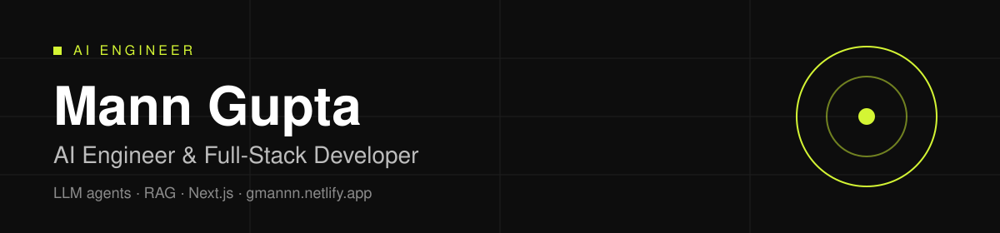

**AI engineer and full-stack developer.** I build AI SaaS MVPs, LLM agents and fast Next.js products, from spec to production.

Founding engineer on three shipped products. One of them is an LLM agent that removed about 70% of manual lead-response work, with a guardrail that hands off to a human when the model is unsure.

## What I build

- **AI SaaS MVPs** with Next.js, Supabase or Postgres, LLM APIs and Stripe
- **LLM agents and RAG** with confidence guardrails, evals and observability
- **Fast marketing sites** in React and Next.js, SEO-ready

## Selected work

| Project | What it does | Stack |
|---|---|---|
| [agentic-support-triage](https://github.com/Mann-gupta1/agentic-support-triage) | Support agent that escalates when it is not confident, with selective-prediction eval | LangGraph, LoRA, Python |
| [Apex-RAG](https://github.com/Mann-gupta1/Apex-RAG) | Multi-modal RAG over text, images, video and audio, with reranking and RAGAS eval | Python |
| [AegisTrace](https://github.com/Mann-gupta1/AegisTrace) | Tracing and eval for multi-step agent pipelines | FastAPI, Postgres, pgvector |
| [next-flow](https://github.com/Mann-gupta1/next-flow) | Visual DAG builder for LLM pipelines | React Flow, Gemini, Trigger.dev |
| [ring-store](https://github.com/Mann-gupta1/ring-store) | 3D ring configurator on a headless WooCommerce backend | React Three Fiber, TypeScript |
| [wedding-planner](https://github.com/Mann-gupta1/wedding-planner) | Indian wedding planner with AI vendor and budget suggestions | TypeScript, Supabase, Gemini |
| [KubeWise](https://github.com/Mann-gupta1/KubeWise) | Finds idle capacity from Prometheus metrics and suggests autoscaling changes | Python, AWS |

More case studies: [gmannn.netlify.app/case-studies](https://gmannn.netlify.app/case-studies)

## Stack

